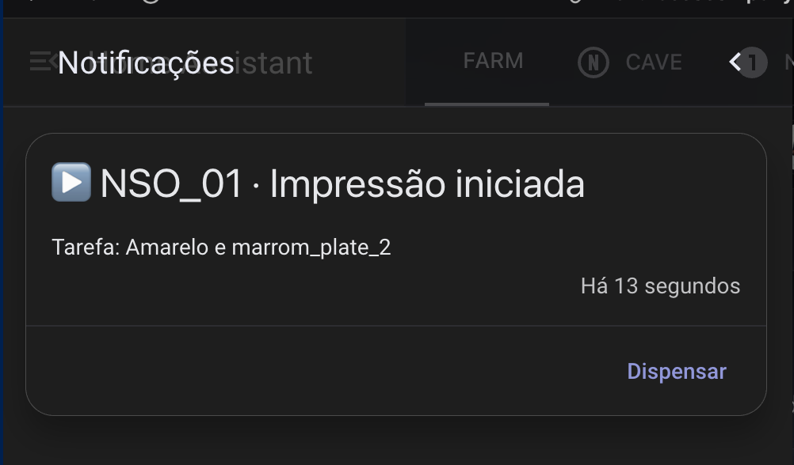

# Notificações completas das impressoras Bambu Lab no Home Assistant

*Motivo real de cada pausa, aviso de sucesso, e um jeito de nunca mais perder impressão por esquecer de confirmar a extrusão.*

---

## Sobre mim

E aí, sou o **RancorosoX**, um entusiasta de impressão 3D e casa inteligente. Monto e automatizo tudo que dá na minha oficina, hoje rodando uma pequena "print farm" com impressoras Bambu Lab integradas ao Home Assistant.

O que me fez montar esse guia foi uma dor bem específica: minhas notificações só diziam "erro de impressão", sem nunca dizer qual foi o motivo de verdade, e o pior: numa impressora sem AMS eu já perdi **horas de impressão parada** só porque não vi a hora que ela pediu confirmação de extrusão. Resolvi caçar dentro da própria integração o que já existia de informação sendo desperdiçada, e virou este guia. Espero que ajude quem tem o mesmo problema.

Esse é o painel da minha "print farm" hoje, com as duas Bambu Lab (NSO_01 e NSO_02) e o sensor de temperatura/umidade que fica perto do hack:


---

## O problema que isso resolve

Se você tem uma impressora Bambu Lab integrada ao Home Assistant pela integração [`greghesp/ha-bambulab`](https://github.com/greghesp/ha-bambulab), provavelmente já notou isso: quando a impressora pausa ou falha, a notificação que chega é só **"Erro de impressão"**, genérica, sem dizer o que realmente aconteceu. Faltou filamento? Bico entupiu? Erro de temperatura? Você só descobre abrindo o app ou olhando a impressora de perto.

E tem um segundo problema, pior ainda: se você usa uma impressora **sem AMS** [AMS = o sistema que troca de filamento sozinho; sem ele, a troca é manual], depois de carregar o filamento a impressora espera você **confirmar a extrusão** numa tela ou no app antes de voltar a funcionar. Se você não estiver olhando, ela fica parada esperando, e pode ficar assim por **horas** sem que ninguém perceba, porque o aviso oficial da Bambu só aparece uma vez, na hora, sem repetir.

Este guia resolve os dois problemas usando só o que a própria integração já expõe pro Home Assistant, sem nenhum complemento extra.

---

## O que descobrimos

A integração Bambu Lab cria um sensor chamado **`current_stage`** (estágio atual) em cada impressora. Ele tem mais de 80 valores possíveis: a maioria são etapas normais de calibração (nivelamento da mesa, aquecimento, etc.), mas cerca de **15 deles são motivos reais de pausa**, cada um com um nome específico: `paused_filament_runout` (sem filamento), `paused_nozzle_clog` (bico entupido), `paused_heat_bed_temperature_malfunction` (erro de temperatura da mesa), e por aí vai.

Esse dado **já existe e já chega certinho** no Home Assistant. O problema é que a maioria dos exemplos de automação por aí (inclusive os que a gente mesmo tinha configurado) só olha se `print_status` virou `failed`, sem checar qual estágio específico causou aquilo. Este guia usa o `current_stage` diretamente: uma automação para cada motivo, cada uma com uma mensagem específica.

### Sobre a confirmação de extrusão: uma limitação real

Pesquisei antes de escrever isso: **não existe hoje nenhum sensor ou botão oficial** na integração que diga "estou esperando você confirmar a extrusão". Isso está reconhecido pela própria comunidade que mantém o projeto, na [issue #1041](https://github.com/greghesp/ha-bambulab/issues/1041).

O contorno usado aqui é por aproximação: um carregamento normal de filamento dura pouco tempo. Se o estágio `filament_loading` (carregando filamento) ficar **parado por mais de 90 segundos**, é sinal forte de que a impressora está esperando confirmação manual. A partir daí, a automação manda um aviso **a cada 10 segundos**, sem parar, até o estágio mudar, o que só acontece quando alguém confirma (na telinha da impressora, no app, ou por qualquer outro jeito).

Não é um sinal 100% oficial, é uma inferência. Mas resolve o problema de verdade.

---

## Antes de começar

1. Você precisa ter a integração **Bambu Lab** (`greghesp/ha-bambulab`) já instalada e configurada no seu Home Assistant, com sua impressora conectada.
2. Você precisa ter o **app do Home Assistant no celular** conectado (pra `notify.notify` funcionar). Se não tiver, troque `notify.notify` por `persistent_notification.create` em todos os blocos abaixo, ou pela sua notificação preferida.
3. Você vai precisar saber o **identificador da sua impressora** dentro do Home Assistant. Ele aparece nas entidades como `sensor.SEU_ID_current_stage`, `light.SEU_ID_chamber_light`, etc. Geralmente é algo como `a1_03919d573003706` (o número de série da impressora). Pra achar o seu: vá em **Configurações → Dispositivos e Serviços → Entidades**, procure por "current_stage", e veja o nome completo da entidade.

Em todos os códigos abaixo, troque `SEU_ID` pelo identificador da sua impressora, e `Minha Impressora` pelo nome que você quiser mostrar nas notificações.

---

## Como colar isso no seu Home Assistant

Duas formas, escolha a que preferir:

**Opção 1: pelo editor visual (mais fácil):**
1. Vá em **Configurações → Automações e Cenas**.
2. Clique em **Criar Automação → Criar nova automação**.
3. No canto superior direito, clique nos três pontinhos (⋮) e escolha **Editar em YAML**.
4. Apague o que estiver lá, cole o código de uma das automações abaixo, e salve.
5. Repita uma automação por vez pra cada bloco de código que você quiser usar.

**Opção 2: direto no arquivo (mais rápido se você tem várias pra colar):**
1. Acesse o arquivo `automations.yaml` da sua instalação (pelo complemento **File editor**, **Studio Code Server**, ou Samba).
2. Cole os blocos de código no final do arquivo (cada automação começa com `- id:`).
3. Vá em **Configurações → Automações e Cenas → menu de três pontinhos → Recarregar automações** (ou reinicie o Home Assistant).

---

## 1. Motivos de pausa específicos

Este é o núcleo do sistema: uma automação pra cada motivo real de pausa. Aqui está o exemplo completo de uma delas (falta de filamento), as outras seguem exatamente o mesmo formato, só trocando o `to:` do gatilho e o texto da mensagem.

```yaml
- id: minha_impressora_pausa_filamento
  alias: "🚨 Minha Impressora · Sem filamento"
  description: "Avisa quando a impressora pausa por falta de filamento"
  triggers:
    - trigger: state
      entity_id: sensor.SEU_ID_current_stage
      to: paused_filament_runout
  conditions: []
  actions:
    - action: light.turn_on
      target:
        entity_id: light.SEU_ID_chamber_light
    - delay:
        seconds: 2
    - action: camera.snapshot
      target:
        entity_id: camera.SEU_ID_camera
      data:
        filename: "/config/www/snapshots/SEU_ID_pausa_filamento.jpg"
    - action: notify.notify
      data:
        title: "🚨 Minha Impressora · Sem filamento"
        message: >
          Acabou o filamento. Troque o rolo e aperte Retomar quando estiver pronto.
          Tarefa: {{ states('sensor.SEU_ID_task_name') }}
          Camada: {{ states('sensor.SEU_ID_current_layer') }}/{{ states('sensor.SEU_ID_total_layer_count') }}
          Progresso: {{ states('sensor.SEU_ID_print_progress') }}%
        data:
          image: "/local/snapshots/SEU_ID_pausa_filamento.jpg"
    - action: persistent_notification.create
      data:
        title: "🚨 Minha Impressora · Sem filamento"
        message: "Acabou o filamento na Minha Impressora."
        notification_id: SEU_ID_pausa_filamento
  mode: single
```

Pra criar as outras, copie esse bloco inteiro e troque só três coisas: o `id` (no topo), o valor de `to:` no gatilho, e o título/mensagem. Aqui está a lista completa dos 15 motivos que valem a pena cobrir:

| Valor de `to:` | Título sugerido | Gravidade |
|---|---|---|
| `paused_filament_runout` | Sem filamento | 🚨 Urgente |
| `paused_nozzle_clog` | Bico entupido | 🚨 Urgente |
| `paused_ams_lost` | AMS perdeu comunicação | 🚨 Urgente |
| `paused_cutter_error` | Erro no cortador de filamento | 🚨 Urgente |
| `paused_nozzle_temperature_malfunction` | Erro de temperatura do bico | 🚨 Urgente |
| `paused_heat_bed_temperature_malfunction` | Erro de temperatura da mesa | 🚨 Urgente |
| `paused_chamber_temperature_control_error` | Erro de temperatura da câmara | 🚨 Urgente |
| `paused_first_layer_error` | Erro na primeira camada | ⚠️ Atenção |
| `paused_front_cover_falling` | Tampa da frente aberta ou caiu | ⚠️ Atenção |
| `paused_low_fan_speed_heat_break` | Ventoinha do bico devagar | ⚠️ Atenção |
| `paused_nozzle_filament_covered_detected` | Filamento cobrindo o sensor do bico | ⚠️ Atenção |
| `paused_skipped_step` | Uma etapa foi pulada | ⚠️ Atenção |
| `paused_user` | Pausado por você | ⏸️ Informativo |
| `paused_user_gcode` | Pausa programada no arquivo | ⏸️ Informativo |
| `m400_pause` | Pausa de segurança da máquina | ⏸️ Informativo |

> **Nota:** nem toda impressora Bambu tem todos os componentes (por exemplo, cortador automático é só em alguns modelos). As automações pra estágios que sua impressora nunca usa simplesmente nunca disparam, não tem problema deixar todas cadastradas.

---

## 2. Impressão iniciada e concluída com sucesso

Duas automações separadas: sucesso é o aviso que normalmente falta em qualquer configuração que só olha erro.

```yaml
- id: minha_impressora_iniciada
  alias: "▶️ Minha Impressora · Impressão iniciada"
  triggers:
    - trigger: state
      entity_id: sensor.SEU_ID_print_status
      to: running
      from: [idle, prepare, slicing]
  conditions: []
  actions:
    - action: notify.notify
      data:
        title: "▶️ Minha Impressora · Impressão iniciada"
        message: >
          Tarefa: {{ states('sensor.SEU_ID_task_name') }}
          Total de camadas: {{ states('sensor.SEU_ID_total_layer_count') }}
  mode: single
```

```yaml
- id: minha_impressora_concluida
  alias: "🎉 Minha Impressora · Impressão concluída com sucesso"
  triggers:
    - trigger: state
      entity_id: sensor.SEU_ID_print_status
      to: finish
  conditions: []
  actions:
    - action: light.turn_on
      target:
        entity_id: light.SEU_ID_chamber_light
    - delay:
        seconds: 2
    - action: camera.snapshot
      target:
        entity_id: camera.SEU_ID_camera
      data:
        filename: "/config/www/snapshots/SEU_ID_concluida.jpg"
    - action: notify.notify
      data:
        title: "🎉 Minha Impressora · Impressão concluída com sucesso"
        message: >
          Tarefa: {{ states('sensor.SEU_ID_task_name') }}
          Peso usado: {{ states('sensor.SEU_ID_print_weight') }}g
        data:
          image: "/local/snapshots/SEU_ID_concluida.jpg"
    - action: persistent_notification.create
      data:
        title: "🎉 Minha Impressora · Impressão concluída"
        message: "Tarefa concluída: {{ states('sensor.SEU_ID_task_name') }}"
        notification_id: SEU_ID_concluida
  mode: single
```

---

## 3. A estrela do guia: aviso repetido pra confirmar extrusão

Essa é a automação feita pra resolver o problema de impressão parada esperando confirmação sem ninguém perceber. Ela usa um `repeat: while` [repete enquanto uma condição continuar verdadeira], que verifica a cada 10 segundos se o estágio ainda está em "carregando filamento", assim que mudar, o aviso para sozinho.

```yaml
- id: minha_impressora_confirmar_extrusao
  alias: "🔁 Minha Impressora · Aguardando confirmar extrusão"
  description: >
    Não existe sinal oficial da integração pra "aguardando confirmação".
    Detecção por aproximação: se o estágio de carregar filamento ficar
    parado por mais de 90 segundos, entende-se como travado esperando
    confirmação manual. Repete o aviso a cada 10s até o estágio mudar.
  triggers:
    - trigger: state
      entity_id: sensor.SEU_ID_current_stage
      to: filament_loading
      for:
        seconds: 90
  conditions: []
  actions:
    - action: light.turn_on
      target:
        entity_id: light.SEU_ID_chamber_light
    - repeat:
        while:
          - condition: state
            entity_id: sensor.SEU_ID_current_stage
            state: filament_loading
        sequence:
          - action: notify.notify
            data:
              title: "🔁 Minha Impressora · Confirme a extrusão!"
              message: >
                A impressora está esperando você confirmar que o filamento
                saiu certinho. Vá na telinha dela ou no app e confirme.
                Esse aviso repete a cada 10s até você resolver.
          - action: persistent_notification.create
            data:
              title: "🔁 Minha Impressora · Confirme a extrusão!"
              message: "Vá na telinha da impressora ou no app e confirme a extrusão."
              notification_id: SEU_ID_confirmar_extrusao
          - delay:
              seconds: 10
    - action: persistent_notification.dismiss
      data:
        notification_id: SEU_ID_confirmar_extrusao
  mode: single
```

**Importante:** ajuste o `for: seconds: 90` conforme o tempo normal de carregamento da sua impressora, se a sua demora mais que isso pra carregar de verdade, aumente esse número pra não disparar aviso à toa.

---

## 4. Bônus: outros avisos que a Bambu já manda e ninguém usa

Curtos e diretos, cada um é uma automação de poucas linhas.

**Atualização de firmware disponível:**
```yaml
- id: minha_impressora_firmware
  alias: "🔧 Minha Impressora · Atualização de firmware disponível"
  triggers:
    - trigger: state
      entity_id: binary_sensor.SEU_ID_firmware
      to: "on"
  actions:
    - action: notify.notify
      data:
        title: "🔧 Atualização de firmware disponível"
        message: "Tem uma versão nova pra instalar pelo app."
  mode: single
```

**Sinal Wi-Fi fraco:**
```yaml
- id: minha_impressora_wifi_fraco
  alias: "📶 Minha Impressora · Sinal Wi-Fi fraco"
  triggers:
    - trigger: numeric_state
      entity_id: sensor.SEU_ID_wi_fi_signal
      below: -75
  actions:
    - action: notify.notify
      data:
        title: "📶 Sinal Wi-Fi fraco"
        message: >
          Sinal em {{ states('sensor.SEU_ID_wi_fi_signal') }} dBm.
          Pode cair da rede no meio de uma impressão se piorar.
  mode: single
  max_exceeded: silent
```

**Lembrete de manutenção por horas de uso** (a cada 500h):
```yaml
- id: minha_impressora_manutencao
  alias: "⏱️ Minha Impressora · Lembrete de manutenção"
  triggers:
    - trigger: numeric_state
      entity_id: sensor.SEU_ID_total_usage
      above: 500
      id: marco_500
    - trigger: numeric_state
      entity_id: sensor.SEU_ID_total_usage
      above: 1000
      id: marco_1000
    - trigger: numeric_state
      entity_id: sensor.SEU_ID_total_usage
      above: 1500
      id: marco_1500
  actions:
    - action: notify.notify
      data:
        title: "⏱️ Hora de revisar"
        message: >
          Passou de {{ trigger.id.split('_')[1] }} horas de uso.
          Vale olhar correias, trilhos e bico.
  mode: single
```

**Cartão SD ausente ou com problema:**
```yaml
- id: minha_impressora_sd_card
  alias: "💾 Minha Impressora · Cartão SD com problema"
  triggers:
    - trigger: state
      entity_id: sensor.SEU_ID_sd_card_status
      to: [missing, abnormal]
  actions:
    - action: notify.notify
      data:
        title: "💾 Cartão SD com problema"
        message: "Status: {{ states('sensor.SEU_ID_sd_card_status') }}. Timelapse e gravação local podem não funcionar."
  mode: single
```

**Controle bloqueado** (alguém mexendo direto na telinha, o Home Assistant pode perder o controle temporariamente):
```yaml
- id: minha_impressora_controle_bloqueado
  alias: "🖐️ Minha Impressora · Controle bloqueado"
  triggers:
    - trigger: state
      entity_id: binary_sensor.SEU_ID_hybrid_mqtt_control_blocked
      to: "on"
  actions:
    - action: notify.notify
      data:
        title: "🖐️ Controle bloqueado"
        message: "Alguém está mexendo direto na tela da impressora."
  mode: single
```

---

## 5. Painel de controle: escolha quais avisos quer receber, sem mexer em código

Com 46 automações rodando, cedo ou tarde algum aviso vai te incomodar mais do que ajudar (comigo foi o de sinal Wi-Fi fraco, disparando toda hora mesmo com o sinal bom). Em vez de ficar entrando em cada automação pra desativar, dá pra montar uma página só com um interruptor para cada aviso.

### O painel

Assim ficou o meu, com os 46 avisos organizados por categoria (cada bloco é um card `entities` separado):


Cada automação já é, por padrão, uma entidade que liga e desliga sozinha (é assim que o Home Assistant trata toda automação). Então um card `entities` simples, listando as automações, já vira um painel de controle:

```yaml
type: entities
title: "🚨 Motivos de pausa - urgentes"
show_header_toggle: false
entities:
  - entity: automation.minha_impressora_pausa_filamento
    secondary_info: last-triggered
  - entity: automation.minha_impressora_bico_entupido
    secondary_info: last-triggered
```

O `secondary_info: last-triggered` é opcional, mas é útil: mostra embaixo do nome quando foi a última vez que aquele aviso disparou, então dá pra ver de cara quais estão "barulhentos" e quais nunca dispararam.

Repita esse bloco pra cada categoria de aviso (motivos de pausa, ciclo de vida, avisos extras, etc), uma abaixo da outra, numa aba nova só pra isso.

### Escondendo a aba da barra de navegação

Uma aba cheia de 46+ interruptores não precisa ficar visível o tempo todo competindo com as abas de verdade (câmera, controles). Dá pra deixá-la "escondida", mas ainda acessível por um botão específico:

1. Crie a aba normalmente (**Editar Dashboard → Adicionar Aba**), com os cards de cima.
2. No modo YAML dessa aba (editar a view, não o card), adicione a propriedade `visible: false` no nível da view (mesmo nível de `title` e `path`, fora de qualquer card):

```yaml
title: AVISOS
path: avisos
icon: mdi:bell-cog
visible: false   # <- some da barra de abas, mas continua existindo
cards:
  - ...
```

Isso faz a aba sumir da barra de cima, mas ela continua funcionando normalmente pra quem souber o caminho até ela.

### O botão de acesso

Pra chegar até a aba escondida, adicione um card pequeno (ex: `mushroom-template-card`, do complemento Mushroom) em algum lugar visível, com uma ação de "navegar" apontando pro caminho da aba escondida:

```yaml
type: custom:mushroom-template-card
primary: "🔔 Avisos e Notificações"
secondary: "Toque pra escolher quais notificações receber"
icon: mdi:bell-cog
icon_color: amber
tap_action:
  action: navigate
  navigation_path: /SEU-PAINEL/avisos   # troque SEU-PAINEL pelo nome do seu dashboard
```

O `navigation_path` segue o formato `/nome-do-seu-dashboard/caminho-da-aba` (o "caminho da aba" é o campo `path` que você deu pra ela no passo anterior). Coloquei esse botão dentro da página de detalhes de cada impressora, então de qualquer uma delas dá um toque e já cai direto na central de avisos.

---

## Resumo do que você ganha com isso

- Sabe **exatamente** por que a impressora pausou, sem precisar abrir o app.
- Recebe aviso de **sucesso**, não só de erro.
- **Nunca mais perde horas** de impressão parada esperando confirmação de extrusão sem perceber.
- Todo aviso chega **duas vezes**: no celular (`notify.notify`) e na própria tela do Home Assistant (`persistent_notification.create`, o sino de notificações), útil se você usa mais o painel do que o celular.

Prova real, print da automação de "impressão iniciada" chegando nos dois lugares ao mesmo tempo:

<table>
<tr>
<td width="50%"></td>
<td width="50%"></td>
</tr>
<tr>
<td align="center"><em>No celular (app do Home Assistant)</em></td>
<td align="center"><em>Na tela do Home Assistant (sino de notificações)</em></td>
</tr>
</table>

Se algum estágio de pausa da sua impressora não está nessa lista, procure pela entidade `sensor.SEU_ID_current_stage` no painel **Ferramentas de Desenvolvedor → Estados**, veja o atributo `options`, e vai encontrar a lista completa de valores que a sua impressora especificamente suporta.

---

## Fontes

- Integração [`greghesp/ha-bambulab`](https://github.com/greghesp/ha-bambulab), Home Assistant Community Store.
- [Issue #1041](https://github.com/greghesp/ha-bambulab/issues/1041): confirmação da ausência de sinal oficial pra extrusão em impressoras sem AMS.
- Documentação oficial de [ações repetidas do Home Assistant](https://www.home-assistant.io/docs/scripts/#repeat-a-group-of-actions) (`repeat: while`).

*Guia testado em duas impressoras Bambu Lab A1 (uma com AMS, outra sem), Home Assistant 2026.8.*
