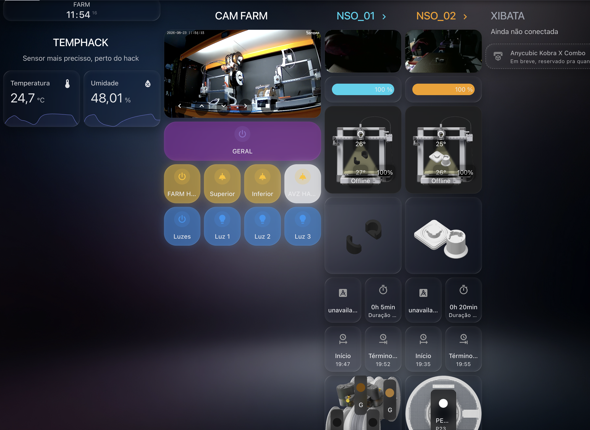
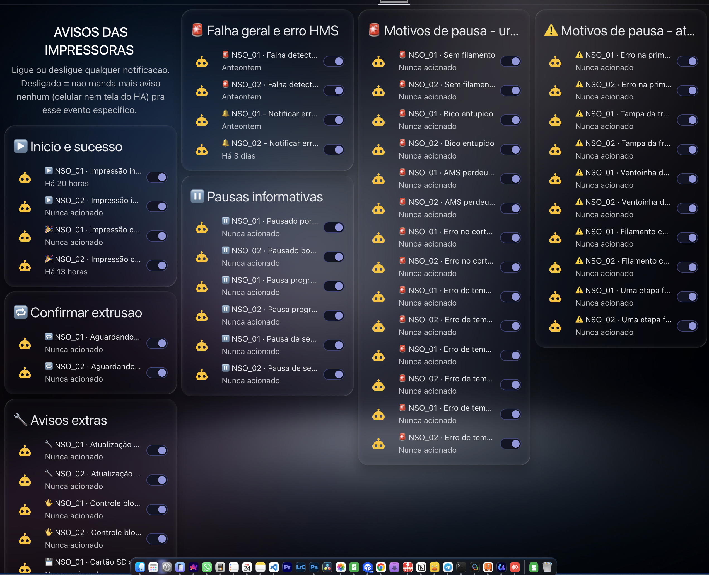
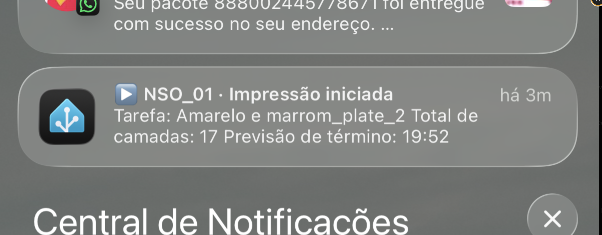

# Notificações completas das impressoras Bambu Lab no Home Assistant

*Motivo real de cada pausa, aviso de sucesso, e um jeito de nunca mais perder impressão por esquecer de confirmar a extrusão.*

---

> ### Novidades (novembro de 2026)
> - **[Firmware novo das A1 e os botões](#atenção-firmware-novo-das-a1-e-os-botões):** leia antes de montar qualquer botão de Retomar ou Parar.
> - **[Central de pausa e falha](#11-versão-nova-uma-central-só-no-lugar-das-15-automações):** uma automação só no lugar das 15, que repete o aviso até a impressora voltar.
> - **[Alarme de queda de energia no meio da impressão](#6-alarme-de-queda-de-energia-no-meio-da-impressão)**, com filtro contra alarme falso.
> - **Correções:** o aviso de "concluída" parou de repetir toda vez que a impressora cai do Wi-Fi e volta (aqui foram 126 avisos em 7 dias) e o aviso de extrusão agora substitui o anterior e some do celular quando você resolve.
> - **Guia novo:** [Anycubic Kobra X com ACE 2 Pro no Home Assistant](https://github.com/Rancoroso-X/kobra-x-home-assistant), com painel montado em cima da foto da impressora.

---

## Sobre mim

E aí, sou o **RancorosoX**, um entusiasta de impressão 3D e casa inteligente. Monto e automatizo tudo que dá na minha oficina, hoje rodando uma pequena "print farm" com impressoras Bambu Lab integradas ao Home Assistant.

O que me fez montar esse guia foi uma dor bem específica: minhas notificações só diziam "erro de impressão", sem nunca dizer qual foi o motivo de verdade, e o pior: numa impressora sem AMS eu já perdi **horas de impressão parada** só porque não vi a hora que ela pediu confirmação de extrusão. Resolvi caçar dentro da própria integração o que já existia de informação sendo desperdiçada, e virou este guia. Espero que ajude quem tem o mesmo problema.

Esse é o painel da minha "print farm" hoje, com as duas Bambu Lab (NSO_01 e NSO_02) e o sensor de temperatura/umidade que fica perto do hack:



---

## O problema que isso resolve

Se você tem uma impressora Bambu Lab integrada ao Home Assistant pela integração [`greghesp/ha-bambulab`](https://github.com/greghesp/ha-bambulab), provavelmente já notou isso: quando a impressora pausa ou falha, a notificação que chega é só **"Erro de impressão"**, genérica, sem dizer o que realmente aconteceu. Faltou filamento? Bico entupiu? Erro de temperatura? Você só descobre abrindo o app ou olhando a impressora de perto.

E tem um segundo problema, pior ainda: se você usa uma impressora **sem AMS** [AMS = o sistema que troca de filamento sozinho; sem ele, a troca é manual], depois de carregar o filamento a impressora espera você **confirmar a extrusão** numa tela ou no app antes de voltar a funcionar. Se você não estiver olhando, ela fica parada esperando, e pode ficar assim por **horas** sem que ninguém perceba, porque o aviso oficial da Bambu só aparece uma vez, na hora, sem repetir.

Este guia resolve os dois problemas usando só o que a própria integração já expõe pro Home Assistant, sem nenhum complemento extra.

---

## O que descobrimos

A integração Bambu Lab cria um sensor chamado **`current_stage`** (estágio atual) em cada impressora. Ele tem mais de 80 valores possíveis: a maioria são etapas normais de calibração (nivelamento da mesa, aquecimento, etc.), mas cerca de **15 deles são motivos reais de pausa**, cada um com um nome específico: `paused_filament_runout` (sem filamento), `paused_nozzle_clog` (bico entupido), `paused_heat_bed_temperature_malfunction` (erro de temperatura da mesa), e por aí vai.

Esse dado **já existe e já chega certinho** no Home Assistant. O problema é que a maioria dos exemplos de automação por aí (inclusive os que a gente mesmo tinha configurado) só olha se `print_status` virou `failed`, sem checar qual estágio específico causou aquilo. Este guia usa o `current_stage` diretamente: uma automação para cada motivo, cada uma com uma mensagem específica.

### Sobre a confirmação de extrusão: uma limitação real

Pesquisei antes de escrever isso: **não existe hoje nenhum sensor ou botão oficial** na integração que diga "estou esperando você confirmar a extrusão". Isso está reconhecido pela própria comunidade que mantém o projeto, na [issue #1041](https://github.com/greghesp/ha-bambulab/issues/1041).

O contorno usado aqui é por aproximação: um carregamento normal de filamento dura pouco tempo. Se o estágio `filament_loading` (carregando filamento) ficar **parado por mais de 90 segundos**, é sinal forte de que a impressora está esperando confirmação manual. A partir daí, a automação manda um aviso **a cada 10 segundos**, sem parar, até o estágio mudar, o que só acontece quando alguém confirma (na telinha da impressora, no app, ou por qualquer outro jeito).

Não é um sinal 100% oficial, é uma inferência. Mas resolve o problema de verdade.

---

## Antes de começar

1. Você precisa ter a integração **Bambu Lab** (`greghesp/ha-bambulab`) já instalada e configurada no seu Home Assistant, com sua impressora conectada.
2. Você precisa ter o **app do Home Assistant no celular** conectado (pra `notify.notify` funcionar). Se não tiver, troque `notify.notify` por `persistent_notification.create` em todos os blocos abaixo, ou pela sua notificação preferida.
3. Você vai precisar saber o **identificador da sua impressora** dentro do Home Assistant. Ele aparece nas entidades como `sensor.SEU_ID_current_stage`, `light.SEU_ID_chamber_light`, etc. Geralmente é algo como `a1_0309xxxxxxxxxxx` (`a1_` mais o número de série da impressora). Pra achar o seu: vá em **Configurações → Dispositivos e Serviços → Entidades**, procure por "current_stage", e veja o nome completo da entidade.

Em todos os códigos abaixo, troque `SEU_ID` pelo identificador da sua impressora, e `Minha Impressora` pelo nome que você quiser mostrar nas notificações.

### Atenção: firmware novo das A1 e os botões

Desde o firmware 01.08 das A1 (aqui chegou em novembro de 2026), a Bambu passou a exigir autorização para receber comandos de fora. Na prática:

- **Tudo que é leitura continua funcionando:** estágio, motivo da pausa, progresso, câmera, temperaturas. Todos os avisos deste guia funcionam normalmente.
- **Os botões param de funcionar** (`button.SEU_ID_resume`, `button.SEU_ID_stop`, pausa automática), a não ser que a impressora esteja em **Modo LAN com Modo Desenvolvedor** ligado.

Ligar o Modo Desenvolvedor faz os botões voltarem, mas a impressora sai da nuvem da Bambu (o app Bambu Handy para de funcionar com ela). É uma escolha sua, as duas opções funcionam com este guia. Duas dicas:

1. **Não atualize o firmware por impulso.** Primeiro decida qual dos dois caminhos você quer.
2. A integração tem o sensor `binary_sensor.SEU_ID_developer_lan_mode`. As automações novas deste guia usam ele para **só mostrar o botão Retomar na notificação quando o botão realmente funciona**. Sem Modo Desenvolvedor, o aviso manda retomar pela tela ou pelo app, e você não fica com um botão morto no celular.

---

## Como colar isso no seu Home Assistant

Duas formas, escolha a que preferir:

**Opção 1: pelo editor visual (mais fácil):**
1. Vá em **Configurações → Automações e Cenas**.
2. Clique em **Criar Automação → Criar nova automação**.
3. No canto superior direito, clique nos três pontinhos (⋮) e escolha **Editar em YAML**.
4. Apague o que estiver lá, cole o código de uma das automações abaixo, e salve.
5. Repita uma automação por vez pra cada bloco de código que você quiser usar.

**Opção 2: direto no arquivo (mais rápido se você tem várias pra colar):**
1. Acesse o arquivo `automations.yaml` da sua instalação (pelo complemento **File editor**, **Studio Code Server**, ou Samba).
2. Cole os blocos de código no final do arquivo (cada automação começa com `- id:`).
3. Vá em **Configurações → Automações e Cenas → menu de três pontinhos → Recarregar automações** (ou reinicie o Home Assistant).

---

## 1. Motivos de pausa específicos

Este é o núcleo do sistema: uma automação pra cada motivo real de pausa. Aqui está o exemplo completo de uma delas (falta de filamento), as outras seguem exatamente o mesmo formato, só trocando o `to:` do gatilho e o texto da mensagem.

```yaml
- id: minha_impressora_pausa_filamento
  alias: "🚨 Minha Impressora · Sem filamento"
  description: "Avisa quando a impressora pausa por falta de filamento"
  triggers:
    - trigger: state
      entity_id: sensor.SEU_ID_current_stage
      to: paused_filament_runout
  conditions: []
  actions:
    - action: light.turn_on
      target:
        entity_id: light.SEU_ID_chamber_light
    - delay:
        seconds: 2
    - action: camera.snapshot
      target:
        entity_id: camera.SEU_ID_camera
      data:
        filename: "/config/www/snapshots/SEU_ID_pausa_filamento.jpg"
    - action: notify.notify
      data:
        title: "🚨 Minha Impressora · Sem filamento"
        message: >
          Acabou o filamento. Troque o rolo e aperte Retomar quando estiver pronto.
          Tarefa: {{ states('sensor.SEU_ID_task_name') }}
          Camada: {{ states('sensor.SEU_ID_current_layer') }}/{{ states('sensor.SEU_ID_total_layer_count') }}
          Progresso: {{ states('sensor.SEU_ID_print_progress') }}%
        data:
          image: "/local/snapshots/SEU_ID_pausa_filamento.jpg"
    - action: persistent_notification.create
      data:
        title: "🚨 Minha Impressora · Sem filamento"
        message: "Acabou o filamento na Minha Impressora."
        notification_id: SEU_ID_pausa_filamento
  mode: single
```

Pra criar as outras, copie esse bloco inteiro e troque só três coisas: o `id` (no topo), o valor de `to:` no gatilho, e o título/mensagem. Aqui está a lista completa dos 15 motivos que valem a pena cobrir:

| Valor de `to:` | Título sugerido | Gravidade |
|---|---|---|
| `paused_filament_runout` | Sem filamento | 🚨 Urgente |
| `paused_nozzle_clog` | Bico entupido | 🚨 Urgente |
| `paused_ams_lost` | AMS perdeu comunicação | 🚨 Urgente |
| `paused_cutter_error` | Erro no cortador de filamento | 🚨 Urgente |
| `paused_nozzle_temperature_malfunction` | Erro de temperatura do bico | 🚨 Urgente |
| `paused_heat_bed_temperature_malfunction` | Erro de temperatura da mesa | 🚨 Urgente |
| `paused_chamber_temperature_control_error` | Erro de temperatura da câmara | 🚨 Urgente |
| `paused_first_layer_error` | Erro na primeira camada | ⚠️ Atenção |
| `paused_front_cover_falling` | Tampa da frente aberta ou caiu | ⚠️ Atenção |
| `paused_low_fan_speed_heat_break` | Ventoinha do bico devagar | ⚠️ Atenção |
| `paused_nozzle_filament_covered_detected` | Filamento cobrindo o sensor do bico | ⚠️ Atenção |
| `paused_skipped_step` | Uma etapa foi pulada | ⚠️ Atenção |
| `paused_user` | Pausado por você | ⏸️ Informativo |
| `paused_user_gcode` | Pausa programada no arquivo | ⏸️ Informativo |
| `m400_pause` | Pausa de segurança da máquina | ⏸️ Informativo |

> **Nota:** nem toda impressora Bambu tem todos os componentes (por exemplo, cortador automático é só em alguns modelos). As automações pra estágios que sua impressora nunca usa simplesmente nunca disparam, não tem problema deixar todas cadastradas.

### 1.1 Versão nova: uma central só, no lugar das 15 automações

Depois de uns meses usando as 15 automações, troquei tudo por uma só por impressora. Os motivos:

- **15 automações dão trabalho para manter.** Qualquer ajuste no texto ou na foto vira 15 edições (30, com duas impressoras).
- **O aviso vinha uma vez só.** Se eu não visse, a impressora ficava parada do mesmo jeito. A central **repete a cada 5 minutos** enquanto ela estiver pausada, diz há quanto tempo está parada e manda "voltou a imprimir" quando resolve.
- **Separa o que é grave do que é rotina.** FALHA (bico entupido, temperatura) chega como urgente, AÇÃO (acabou o filamento, tampa) como atenção, e LEMBRETE (pausa programada no arquivo, por exemplo para colocar um ímã ou um NFC no meio da peça) chega como lembrete, sem alarde.
- **Pega também o que não está na lista.** Se o estágio não for nenhum dos 15, ela usa o erro HMS ou o texto de erro que a impressora mandou.

Se você já tinha as 15, desligue elas (não precisa apagar) para não receber aviso dobrado.

```yaml
- id: minha_impressora_central_de_pausa
  alias: "🖨️ Minha Impressora · Central de pausa e falha (avisa até retomar)"
  triggers:
    - trigger: state
      entity_id: sensor.SEU_ID_print_status
      to: pause
      for:
        seconds: 5
    - trigger: state
      entity_id: sensor.SEU_ID_print_status
      to: failed
  actions:
    - variables:
        # estágio: [tipo, motivo, o que fazer]
        motivos:
          paused_nozzle_clog: [falha, "Bico entupido", "Limpe ou troque o bico antes de retomar."]
          paused_nozzle_temperature_malfunction: [falha, "Temperatura do bico com defeito", "Confira o aquecedor e o termistor do bico."]
          paused_heat_bed_temperature_malfunction: [falha, "Temperatura da mesa com defeito", "Confira o cabo e o aquecimento da mesa."]
          paused_chamber_temperature_control_error: [falha, "Erro no controle de temperatura", "Confira ventilação e temperatura ambiente."]
          paused_cutter_error: [falha, "Erro no cortador de filamento", "Confira se o cortador travou."]
          paused_ams_lost: [falha, "AMS perdeu comunicação", "Confira o cabo do AMS."]
          paused_low_fan_speed_heat_break: [falha, "Ventoinha do bico fraca", "Limpe ou troque a ventoinha do bico."]
          paused_skipped_step: [falha, "Motor pulou passo", "Confira se a peça soltou ou algo travou o cabeçote."]
          paused_first_layer_error: [falha, "Erro na primeira camada", "Olhe a câmera: a primeira camada pode ter falhado."]
          paused_nozzle_filament_covered_detected: [falha, "Filamento enrolado no bico", "Limpe o bico (pode ter virado bola de filamento)."]
          paused_filament_runout: [acao, "Acabou o filamento", "Coloque um rolo novo e retome."]
          paused_front_cover_falling: [acao, "Tampa da frente aberta ou caiu", "Recoloque a tampa e retome."]
          paused_user: [lembrete, "Pausa feita na tela ou no app", "Faça o que precisa e retome."]
          paused_user_gcode: [lembrete, "Pausa programada no arquivo", "Faça a troca planejada e retome."]
          m400_pause: [lembrete, "Pausa programada no arquivo", "Faça a troca planejada e retome."]
        inicio: "{{ now().timestamp() }}"
        foto: "/config/www/snapshots/SEU_ID_aviso_{{ now().strftime('%Y%m%d_%H%M%S') }}.jpg"
    - action: light.turn_on
      target:
        entity_id: light.SEU_ID_chamber_light
    - delay:
        seconds: 2
    - action: camera.snapshot
      target:
        entity_id: camera.SEU_ID_camera
      data:
        filename: "{{ foto }}"
      continue_on_error: true
    - repeat:
        sequence:
          - variables:
              estagio: "{{ states('sensor.SEU_ID_current_stage') }}"
              falhou: "{{ is_state('sensor.SEU_ID_print_status', 'failed') }}"
              texto_impressora: "{{ state_attr('binary_sensor.SEU_ID_print_error', 'error') or '' }}"
              hms_gravidade: "{{ state_attr('binary_sensor.SEU_ID_hms_errors', '0-Severity') or '' }}"
              hms_texto: "{{ state_attr('binary_sensor.SEU_ID_hms_errors', '0-Error') or '' }}"
              tipo: >-
                falha{{ motivos[estagio][0] }}falhaacaolembrete
              motivo: >-
                {{ motivos[estagio][1] }}Impressão falhou{{ hms_texto }}{{ texto_impressora }}Pausada sem motivo informado
              o_que_fazer: >-
                {{ motivos[estagio][2] }}Olhe a câmera e a tela da impressora antes de retomar.
              minutos: "{{ ((now().timestamp() - inicio|float) / 60) | round(0) | int }}"
              titulo: >-
                🚨 Minha Impressora · FALHA: {{ motivo }}⚠️ Minha Impressora · {{ motivo }}⏸️ Minha Impressora · Pausada, aguardando você
              mensagem: >-
                {{ motivo }}. {{ o_que_fazer }}
                Parada há {{ minutos }} min.
                {{ states('sensor.SEU_ID_task_name') }} · camada {{ states('sensor.SEU_ID_current_layer') }}/{{ states('sensor.SEU_ID_total_layer_count') }} · {{ states('sensor.SEU_ID_print_progress') }}%
          - action: notify.notify
            data:
              title: "{{ titulo }}"
              message: "{{ mensagem }}"
              data:
                tag: SEU_ID_pausa   # cada aviso novo substitui o anterior, não empilha
                image: "{{ foto | replace('/config/www/', '/local/') }}"
                # botões só aparecem quando funcionam (Modo Desenvolvedor ligado, veja o aviso de firmware)
                actions: >-
                  {{ [{"action": "RETOMAR_SEU_ID", "title": "▶️ Retomar"},
                      {"action": "CANCELAR_SEU_ID", "title": "⏹️ Cancelar impressão", "destructive": true, "authenticationRequired": true}]
                     if is_state('binary_sensor.SEU_ID_developer_lan_mode', 'on') else [] }}
                push:
                  interruption-level: "{{ 'time-sensitive' if tipo != 'lembrete' else 'active' }}"
          - action: persistent_notification.create
            data:
              title: "{{ titulo }}"
              message: "{{ mensagem }}"
              notification_id: SEU_ID_pausa
          - wait_for_trigger:
              - trigger: state
                entity_id: sensor.SEU_ID_print_status
                not_to: [pause]
            timeout:
              minutes: 5
            continue_on_timeout: true
        until:
          - condition: not
            conditions:
              - condition: state
                entity_id: sensor.SEU_ID_print_status
                state: pause
    - action: persistent_notification.dismiss
      data:
        notification_id: SEU_ID_pausa
    - if:
        - condition: state
          entity_id: sensor.SEU_ID_print_status
          state: running
      then:
        - action: notify.notify
          data:
            title: "▶️ Minha Impressora · Voltou a imprimir"
            message: "Ficou parada {{ ((now().timestamp() - inicio|float) / 60) | round(0) | int }} min."
            data:
              tag: SEU_ID_pausa
  mode: single
  max_exceeded: silent
```

O `interruption-level: time-sensitive` faz o aviso de falha furar o modo Foco do iPhone. Os lembretes chegam normais.

**Os botões Retomar e Cancelar do aviso** precisam de uma segunda automação, que escuta o toque no celular e aperta o botão da impressora (só funciona com Modo Desenvolvedor):

```yaml
- id: minha_impressora_botoes_do_aviso
  alias: "🎮 Minha Impressora · Botões do aviso (Retomar e Cancelar)"
  triggers:
    - trigger: event
      event_type: mobile_app_notification_action
      event_data:
        action: RETOMAR_SEU_ID
      id: retomar
    - trigger: event
      event_type: mobile_app_notification_action
      event_data:
        action: CANCELAR_SEU_ID
      id: cancelar
  actions:
    - action: button.press
      target:
        entity_id: "{{ 'button.SEU_ID_resume' if trigger.id == 'retomar' else 'button.SEU_ID_stop' }}"
  mode: queued
```

---

## 2. Impressão iniciada e concluída com sucesso

Duas automações separadas: sucesso é o aviso que normalmente falta em qualquer configuração que só olha erro.

```yaml
- id: minha_impressora_iniciada
  alias: "▶️ Minha Impressora · Impressão iniciada"
  triggers:
    - trigger: state
      entity_id: sensor.SEU_ID_print_status
      to: running
      from: [idle, prepare, slicing]
  conditions:
    - condition: template
      alias: Ignora quando o Home Assistant reiniciou ou a impressora reconectou
      value_template: "{{ trigger.from_state is not none and trigger.from_state.state not in ['unavailable','unknown'] }}"
  actions:
    - action: notify.notify
      data:
        title: "▶️ Minha Impressora · Impressão iniciada"
        message: >
          Tarefa: {{ states('sensor.SEU_ID_task_name') }}
          Total de camadas: {{ states('sensor.SEU_ID_total_layer_count') }}
  mode: single
```

```yaml
- id: minha_impressora_concluida
  alias: "🎉 Minha Impressora · Impressão concluída com sucesso"
  triggers:
    - trigger: state
      entity_id: sensor.SEU_ID_print_status
      to: finish
      from: [running, prepare, pause]   # sem isso, avisa de novo toda vez que cai do Wi-Fi e volta
  conditions:
    - condition: template
      alias: Ignora quando o Home Assistant reiniciou ou a impressora reconectou
      value_template: "{{ trigger.from_state is not none and trigger.from_state.state not in ['unavailable','unknown'] }}"
  actions:
    - action: light.turn_on
      target:
        entity_id: light.SEU_ID_chamber_light
    - delay:
        seconds: 2
    - action: camera.snapshot
      target:
        entity_id: camera.SEU_ID_camera
      data:
        filename: "/config/www/snapshots/SEU_ID_concluida.jpg"
    - action: notify.notify
      data:
        title: "🎉 Minha Impressora · Impressão concluída com sucesso"
        message: >
          Tarefa: {{ states('sensor.SEU_ID_task_name') }}
          Peso usado: {{ states('sensor.SEU_ID_print_weight') }}g
        data:
          image: "/local/snapshots/SEU_ID_concluida.jpg"
    - action: persistent_notification.create
      data:
        title: "🎉 Minha Impressora · Impressão concluída"
        message: "Tarefa concluída: {{ states('sensor.SEU_ID_task_name') }}"
        notification_id: SEU_ID_concluida
  mode: single
```

---

## 3. A estrela do guia: aviso repetido pra confirmar extrusão

Essa é a automação feita pra resolver o problema de impressão parada esperando confirmação sem ninguém perceber. Ela usa um `repeat: while` [repete enquanto uma condição continuar verdadeira], que verifica a cada 10 segundos se o estágio ainda está em "carregando filamento", assim que mudar, o aviso para sozinho.

```yaml
- id: minha_impressora_confirmar_extrusao
  alias: "🔁 Minha Impressora · Aguardando confirmar extrusão"
  description: >
    Não existe sinal oficial da integração pra "aguardando confirmação".
    Detecção por aproximação: se o estágio de carregar filamento ficar
    parado por mais de 90 segundos, entende-se como travado esperando
    confirmação manual. Repete o aviso a cada 10s até o estágio mudar.
  triggers:
    - trigger: state
      entity_id: sensor.SEU_ID_current_stage
      to: filament_loading
      for:
        seconds: 90
  conditions: []
  actions:
    - action: light.turn_on
      target:
        entity_id: light.SEU_ID_chamber_light
    - repeat:
        while:
          - condition: state
            entity_id: sensor.SEU_ID_current_stage
            state: filament_loading
        sequence:
          - action: notify.notify
            data:
              title: "🔁 Minha Impressora · Confirme a extrusão!"
              message: >
                A impressora está esperando você confirmar que o filamento
                saiu certinho. Vá na telinha dela ou no app e confirme.
                Esse aviso repete a cada 10s até você resolver.
              data:
                tag: SEU_ID_extrusao   # cada aviso substitui o anterior, sem encher a tela
                push:
                  interruption-level: time-sensitive   # fura o modo Foco do iPhone
          - action: persistent_notification.create
            data:
              title: "🔁 Minha Impressora · Confirme a extrusão!"
              message: "Vá na telinha da impressora ou no app e confirme a extrusão."
              notification_id: SEU_ID_confirmar_extrusao
          - delay:
              seconds: 10
    - action: persistent_notification.dismiss
      data:
        notification_id: SEU_ID_confirmar_extrusao
    - action: notify.notify   # tira o aviso do celular quando resolve
      data:
        message: clear_notification
        data:
          tag: SEU_ID_extrusao
  mode: single
```

**Importante:** ajuste o `for: seconds: 90` conforme o tempo normal de carregamento da sua impressora, se a sua demora mais que isso pra carregar de verdade, aumente esse número pra não disparar aviso à toa.

---

## 4. Bônus: outros avisos que a Bambu já manda e ninguém usa

Curtos e diretos, cada um é uma automação de poucas linhas.

**Atualização de firmware disponível:**
```yaml
- id: minha_impressora_firmware
  alias: "🔧 Minha Impressora · Atualização de firmware disponível"
  triggers:
    - trigger: state
      entity_id: binary_sensor.SEU_ID_firmware
      to: "on"
  actions:
    - action: notify.notify
      data:
        title: "🔧 Atualização de firmware disponível"
        message: "Tem uma versão nova pra instalar pelo app."
  mode: single
```

**Sinal Wi-Fi fraco:**
```yaml
- id: minha_impressora_wifi_fraco
  alias: "📶 Minha Impressora · Sinal Wi-Fi fraco"
  triggers:
    - trigger: numeric_state
      entity_id: sensor.SEU_ID_wi_fi_signal
      below: -75
  actions:
    - action: notify.notify
      data:
        title: "📶 Sinal Wi-Fi fraco"
        message: >
          Sinal em {{ states('sensor.SEU_ID_wi_fi_signal') }} dBm.
          Pode cair da rede no meio de uma impressão se piorar.
  mode: single
  max_exceeded: silent
```

**Lembrete de manutenção por horas de uso** (a cada 500h):
```yaml
- id: minha_impressora_manutencao
  alias: "⏱️ Minha Impressora · Lembrete de manutenção"
  triggers:
    - trigger: numeric_state
      entity_id: sensor.SEU_ID_total_usage
      above: 500
      id: marco_500
    - trigger: numeric_state
      entity_id: sensor.SEU_ID_total_usage
      above: 1000
      id: marco_1000
    - trigger: numeric_state
      entity_id: sensor.SEU_ID_total_usage
      above: 1500
      id: marco_1500
  actions:
    - action: notify.notify
      data:
        title: "⏱️ Hora de revisar"
        message: >
          Passou de {{ trigger.id.split('_')[1] }} horas de uso.
          Vale olhar correias, trilhos e bico.
  mode: single
```

**Cartão SD ausente ou com problema:**
```yaml
- id: minha_impressora_sd_card
  alias: "💾 Minha Impressora · Cartão SD com problema"
  triggers:
    - trigger: state
      entity_id: sensor.SEU_ID_sd_card_status
      to: [missing, abnormal]
  actions:
    - action: notify.notify
      data:
        title: "💾 Cartão SD com problema"
        message: "Status: {{ states('sensor.SEU_ID_sd_card_status') }}. Timelapse e gravação local podem não funcionar."
  mode: single
```

**Controle bloqueado** (alguém mexendo direto na telinha, o Home Assistant pode perder o controle temporariamente):
```yaml
- id: minha_impressora_controle_bloqueado
  alias: "🖐️ Minha Impressora · Controle bloqueado"
  triggers:
    - trigger: state
      entity_id: binary_sensor.SEU_ID_hybrid_mqtt_control_blocked
      to: "on"
  actions:
    - action: notify.notify
      data:
        title: "🖐️ Controle bloqueado"
        message: "Alguém está mexendo direto na tela da impressora."
  mode: single
```

---

## 5. Painel de controle: escolha quais avisos quer receber, sem mexer em código

Com 46 automações rodando, cedo ou tarde algum aviso vai te incomodar mais do que ajudar (comigo foi o de sinal Wi-Fi fraco, disparando toda hora mesmo com o sinal bom). Em vez de ficar entrando em cada automação pra desativar, dá pra montar uma página só com um interruptor para cada aviso.

### O painel

Assim ficou o meu, com os 46 avisos organizados por categoria (cada bloco é um card `entities` separado):



Cada automação já é, por padrão, uma entidade que liga e desliga sozinha (é assim que o Home Assistant trata toda automação). Então um card `entities` simples, listando as automações, já vira um painel de controle:

```yaml
type: entities
title: "🚨 Motivos de pausa - urgentes"
show_header_toggle: false
entities:
  - entity: automation.minha_impressora_pausa_filamento
    secondary_info: last-triggered
  - entity: automation.minha_impressora_bico_entupido
    secondary_info: last-triggered
```

O `secondary_info: last-triggered` é opcional, mas é útil: mostra embaixo do nome quando foi a última vez que aquele aviso disparou, então dá pra ver de cara quais estão "barulhentos" e quais nunca dispararam.

Repita esse bloco pra cada categoria de aviso (motivos de pausa, ciclo de vida, avisos extras, etc), uma abaixo da outra, numa aba nova só pra isso.

### Escondendo a aba da barra de navegação

Uma aba cheia de 46+ interruptores não precisa ficar visível o tempo todo competindo com as abas de verdade (câmera, controles). Dá pra deixá-la "escondida", mas ainda acessível por um botão específico:

1. Crie a aba normalmente (**Editar Dashboard → Adicionar Aba**), com os cards de cima.
2. No modo YAML dessa aba (editar a view, não o card), adicione a propriedade `visible: false` no nível da view (mesmo nível de `title` e `path`, fora de qualquer card):

```yaml
title: AVISOS
path: avisos
icon: mdi:bell-cog
visible: false   # <- some da barra de abas, mas continua existindo
cards:
  - ...
```

Isso faz a aba sumir da barra de cima, mas ela continua funcionando normalmente pra quem souber o caminho até ela.

### O botão de acesso

Pra chegar até a aba escondida, adicione um card pequeno (ex: `mushroom-template-card`, do complemento Mushroom) em algum lugar visível, com uma ação de "navegar" apontando pro caminho da aba escondida:

```yaml
type: custom:mushroom-template-card
primary: "🔔 Avisos e Notificações"
secondary: "Toque pra escolher quais notificações receber"
icon: mdi:bell-cog
icon_color: amber
tap_action:
  action: navigate
  navigation_path: /SEU-PAINEL/avisos   # troque SEU-PAINEL pelo nome do seu dashboard
```

O `navigation_path` segue o formato `/nome-do-seu-dashboard/caminho-da-aba` (o "caminho da aba" é o campo `path` que você deu pra ela no passo anterior). Coloquei esse botão dentro da página de detalhes de cada impressora, então de qualquer uma delas dá um toque e já cai direto na central de avisos.

---

## 6. Alarme de queda de energia no meio da impressão

Quando a energia pisca, a A1 volta ligada mas **parada**, perguntando se quer continuar o trabalho. Se ninguém vê, a mesa esfria e a peça solta. Este alarme toca como alarme de verdade (fura o silencioso e o Foco) e repete a cada 20 segundos até a impressão voltar, até você tocar em "Ciente" ou por no máximo 2 horas.

Ele dispara em três situações:

1. **A impressora volta avisando "trabalho inacabado"** (código de erro `0300_8007`). É o sinal mais confiável e não precisa de nada extra.
2. **A tomada inteligente da impressora desligou** (se você tiver uma).
3. **A impressora sumiu da rede enquanto imprimia por mais de 3 minutos.** Esse é o que pode dar alarme falso: o Wi-Fi da impressora oscila e ela some por alguns segundos. Os 3 minutos filtram a maioria. Se ainda incomodar, apague esse gatilho.

> **Filtro melhor, se você tem tomada Zigbee:** aqui eu chamo a tomada pelo Zigbee2MQTT assim que a impressora some. Se a tomada responde, tem energia, então foi só o Wi-Fi e o alarme é descartado. Depende de como cada um montou o Zigbee, por isso deixei de fora do código.

Troque `switch.TOMADA_DA_IMPRESSORA` pela sua tomada ou apague o segundo gatilho se não tiver.

```yaml
- id: minha_impressora_queda_de_energia
  alias: "⚡ Minha Impressora · Queda de energia no meio da impressão (alarme repetido)"
  triggers:
    - trigger: template
      id: voltou_com_trabalho_inacabado
      value_template: "{{ state_attr('binary_sensor.SEU_ID_print_error', 'code') == '0300_8007' }}"
    - trigger: state
      id: tomada_desligou
      entity_id: switch.TOMADA_DA_IMPRESSORA
      from: "on"
      to: ["off", "unavailable"]
    - trigger: state
      id: sumiu_da_rede
      entity_id: sensor.SEU_ID_print_status
      from: [running, prepare, pause]
      to: offline
      for:
        minutes: 3
  conditions:
    - condition: template
      alias: Tomada desligando só conta se estava imprimindo
      value_template: >-
        {{ trigger.id != 'tomada_desligou' or states('sensor.SEU_ID_print_status') in ['running','prepare','pause','offline'] }}
  actions:
    - repeat:
        sequence:
          - action: notify.notify
            data:
              title: "⚡ Minha Impressora · QUEDA DE ENERGIA na impressão!"
              message: >-
                A impressora perdeu energia no meio da impressão. Olhe a câmera e, se a peça estiver no lugar,
                toque em Retomar aquiretome na tela da impressora ou no app.
                Quanto mais demora, mais a mesa esfria e a peça pode soltar.
              data:
                tag: SEU_ID_queda
                ttl: 0
                priority: high
                channel: alarm_stream          # Android: toca como alarme
                push:
                  interruption-level: critical # iPhone: fura o silencioso
                  sound:
                    name: default
                    critical: 1
                    volume: 1.0
                actions: >-
                  {{ ([{'action': 'RETOMAR_SEU_ID', 'title': '▶️ Retomar impressão'}]
                      if is_state('binary_sensor.SEU_ID_developer_lan_mode', 'on') else [])
                     + [{'action': 'CIENTE_QUEDA_SEU_ID', 'title': 'Ciente (parar alarme)'}] }}
          - wait_for_trigger:
              - trigger: event
                event_type: mobile_app_notification_action
                event_data:
                  action: CIENTE_QUEDA_SEU_ID
            timeout:
              seconds: 20
            continue_on_timeout: true
        until:
          - condition: template
            value_template: >-
              {{ wait.trigger is not none
                 or repeat.index >= 360
                 or (states('sensor.SEU_ID_print_status') in ['running','prepare']
                     and (now() - states.sensor.SEU_ID_print_status.last_changed).total_seconds() > 60) }}
    - action: notify.notify
      data:
        message: clear_notification
        data:
          tag: SEU_ID_queda
  mode: single
  max_exceeded: silent
```

O botão "Retomar" do alarme usa a mesma automação de botões da [seção 1.1](#11-versão-nova-uma-central-só-no-lugar-das-15-automações). No iPhone, o alarme crítico só toca se você permitir "Alertas críticos" para o app do Home Assistant (Ajustes → Notificações → Home Assistant).

---

## Resumo do que você ganha com isso

- Sabe **exatamente** por que a impressora pausou, sem precisar abrir o app, e o aviso **repete até você resolver**.
- Fica sabendo na hora quando a **energia cai** no meio de uma impressão.
- Recebe aviso de **sucesso**, não só de erro.
- **Nunca mais perde horas** de impressão parada esperando confirmação de extrusão sem perceber.
- Todo aviso chega **duas vezes**: no celular (`notify.notify`) e na própria tela do Home Assistant (`persistent_notification.create`, o sino de notificações), útil se você usa mais o painel do que o celular.

Prova real, print da automação de "impressão iniciada" chegando nos dois lugares ao mesmo tempo:

<table>
<tr>
<td width="50%"></td>
<td width="50%"></td>
</tr>
<tr>
<td align="center"><em>No celular (app do Home Assistant)</em></td>
<td align="center"><em>Na tela do Home Assistant (sino de notificações)</em></td>
</tr>
</table>

Se algum estágio de pausa da sua impressora não está nessa lista, procure pela entidade `sensor.SEU_ID_current_stage` no painel **Ferramentas de Desenvolvedor → Estados**, veja o atributo `options`, e vai encontrar a lista completa de valores que a sua impressora especificamente suporta.

---

## Fontes

- Integração [`greghesp/ha-bambulab`](https://github.com/greghesp/ha-bambulab), Home Assistant Community Store.
- [Issue #1041](https://github.com/greghesp/ha-bambulab/issues/1041): confirmação da ausência de sinal oficial pra extrusão em impressoras sem AMS.
- Documentação oficial de [ações repetidas do Home Assistant](https://www.home-assistant.io/docs/scripts/#repeat-a-group-of-actions) (`repeat: while`).

- Documentação oficial das [notificações críticas e com botões do app](https://companion.home-assistant.io/docs/notifications/critical-notifications/).

*Guia testado em duas impressoras Bambu Lab A1 (uma com AMS, outra sem). Escrito com o Home Assistant 2026.8 e atualizado em novembro de 2026, com as A1 no firmware 01.08.*

*Tem também uma Anycubic Kobra X? Veja o [guia da Kobra X com ACE 2 Pro](https://github.com/Rancoroso-X/kobra-x-home-assistant).*
